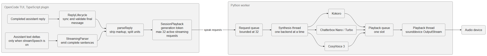

# Voice plugin

Local text-to-speech for completed OpenCode TUI replies on Windows. Choose Kokoro, Chatterbox Nano, or Chatterbox Turbo. Fenced code is skipped; the saved transcript is unchanged.

## How it works




```text
src/
├── opencode/index.ts          Plugin setup, commands and final-reply selection
└── shared/                    Parsing, session playback and worker transport
worker/
├── main.py                    Request queue, backend dispatch and playback
├── delivery.py                Kokoro emotion-to-speed mapping
├── chatterbox_backend.py      Chatterbox loading and synthesis
└── conditioning_cache.py      Custom-voice conditioning cache
tests/                         TypeScript and Python tests
```

## Install

Requirements: OpenCode v2.2.6, Node.js, npm, Python 3.12, and an audio output device. Kokoro uses the bundled eSpeak library when available; otherwise, install and configure eSpeak NG. Existing `PHONEMIZER_ESPEAK_LIBRARY` and `PHONEMIZER_ESPEAK_DATA_PATH` settings are respected.

From the plugin directory in PowerShell:

```powershell
npm install
py -3.12 -m venv .venv
.\.venv\Scripts\python.exe -m pip install -e .
```

Add the plugin to the global OpenCode TUI `cli.json` (not the server config). Replace the paths with absolute paths on your machine:

```json
{
  "plugins": [
    {
      "package": "C:\\path\\to\\voice-plugin",
      "options": {
        "projectRoot": "C:\\path\\to\\voice-plugin",
        "python": "C:\\path\\to\\voice-plugin\\.venv\\Scripts\\python.exe",
        "voice": "af_heart",
        "speed": 1.0
      }
    }
  ]
}
```

All options are optional. Kokoro is the default backend, with voice `af_heart`, speed `1.0`, and Python at `<projectRoot>\.venv\Scripts\python.exe`. Kokoro voice names must start with `af_`, `am_`, `bf_`, or `bm_`; speed must be between `0.7` and `1.3`.

Model weights download on first use. Set `HF_TOKEN` before starting OpenCode to authenticate Hugging Face downloads; if it is unset or blank, downloads are anonymous even when a Hub login is cached. Cached models work without another download.

## Chatterbox

Install Chatterbox separately to avoid changing Kokoro's dependencies:

```powershell
py -3.12 -m venv .venv-chatterbox
.\.venv-chatterbox\Scripts\python.exe -m pip install --upgrade pip
.\.venv-chatterbox\Scripts\python.exe -m pip install "git+https://github.com/resemble-ai/chatterbox.git@ab55923c27757c90cfcc407baa57dc25a7d25217" "sounddevice==0.5.6"
```

Git and network access are required. This pins the Chatterbox source, not its model weights or every dependency. Upstream pins PyTorch and torchaudio 2.6.0 for Python 3.12, tested on Debian rather than Windows; alternative GPU runtimes may conflict with those pins. The upstream project is retired and unsupported.

Set the following plugin options, choosing `chatterbox-nano` or `chatterbox-turbo`:

```json
{
  "projectRoot": "C:\\path\\to\\voice-plugin",
  "backend": "chatterbox-turbo",
  "chatterboxPython": "C:\\path\\to\\voice-plugin\\.venv-chatterbox\\Scripts\\python.exe",
  "referenceAudio": "C:\\path\\to\\voice-reference.wav"
}
```

`chatterboxPython` falls back to `python` when omitted. `referenceAudio` is optional and must be an absolute path. Without it, Chatterbox uses its bundled voice conditioning if available. For a custom voice, use a clean recording longer than five seconds; upstream examples use about ten seconds. Only clone a voice with permission.

The first use of a reference saves voice conditioning in `.voice-cache`, which is excluded from Git. Later requests and restarts can use the cache even if the reference file is missing, provided `referenceAudio` still points to the same path. Entries are separate for Nano, Turbo, and different model weights; changing the recording refreshes its cache. A corrupt entry requires the reference to rebuild. Delete `.voice-cache` to remove the voice-derived data.

The worker tries a PyTorch `cuda` device when available, including compatible AMD ROCm runtimes, and falls back to CPU with a diagnostic if GPU loading or synthesis fails. CPU inference can be slow. Installing an AMD-compatible PyTorch build is hardware-specific and may conflict with Chatterbox's pinned dependencies.

### Chatterbox sounds and moods

Nano and Turbo accept sound tags inline. The [official Turbo demo](https://huggingface.co/spaces/ResembleAI/chatterbox-turbo-demo) lists:

`[clear throat]`, `[sigh]`, `[shush]`, `[cough]`, `[groan]`, `[sniff]`, `[gasp]`, `[chuckle]`, `[laugh]`

For example: `That's funny! [chuckle] Anyway, let's continue.` The model may not produce an audible effect every time.

These are sound events, not mood controls. The plugin does not expose Chatterbox mood settings or map its emotion spans to Chatterbox; Kokoro's `voice`, `speed`, and emotion-speed settings do not change Chatterbox output.

## Controls and emotions

- `/voice-on` enables speech for the current session.
- `/voice-off` disables speech and cancels its current request.
- `/voice-stop` cancels the current request without disabling future speech.

Speech starts enabled in each session. A new answer cancels that session's previous request. In-progress synthesis cannot be forcibly interrupted, but cancelled audio is suppressed.

For optional emotion spans, ask the assistant to use non-nested tags such as:

```text
[voice emotions="calm:0.3,reassuring:0.7"]Take your time.[/voice]
```

Supported emotions are `calm`, `excited`, `sad`, `reassuring`, and `serious`, with weights from 0 to 1. Invalid names or weights are ignored. Raw tags may remain visible in the transcript but are removed from speech.

Kokoro approximates emotion by adjusting speed: `calm -0.12`, `excited +0.18`, `sad -0.16`, `reassuring -0.08`, and `serious -0.06`, multiplied by their weights and clamped to `0.7–1.3`. Chatterbox does not apply these speed adjustments or translate the weights into sound tags.

## Checks

```powershell
npm test
npm run check
.\.venv\Scripts\python.exe -m unittest discover -s tests
```

If playback fails, check the selected audio device, model downloads, and eSpeak configuration for Kokoro. If the worker exits, fix the error and restart OpenCode; it does not automatically retry.
