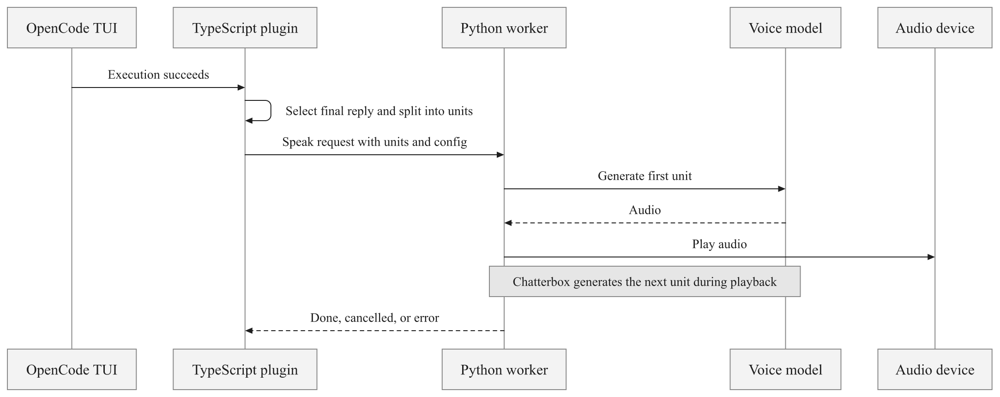

# Voice plugin

Local text-to-speech for completed OpenCode TUI replies on Windows. Choose Kokoro, Chatterbox Nano, Chatterbox Turbo, or CosyVoice 3. Fenced code is skipped and the saved transcript is unchanged.

## Quick start

Requirements: OpenCode v2.2.6, Node.js, npm, Python 3.12, and an audio output device. Kokoro uses the bundled eSpeak library when available. Otherwise, install and configure eSpeak NG. Existing `PHONEMIZER_ESPEAK_LIBRARY` and `PHONEMIZER_ESPEAK_DATA_PATH` settings are respected.

From the plugin directory in PowerShell:

```powershell
npm install
py -3.12 -m venv .venv
.\.venv\Scripts\python.exe -m pip install -e .
```

Add the plugin to the global OpenCode TUI `cli.json`, not the server config. Replace the paths with absolute paths on your machine:

```json
{
  "plugins": [
    {
      "package": "C:\\path\\to\\voice-plugin",
      "options": {
        "projectRoot": "C:\\path\\to\\voice-plugin",
        "python": "C:\\path\\to\\voice-plugin\\.venv\\Scripts\\python.exe",
        "voice": "af_heart",
        "speed": 1.0
      }
    }
  ]
}
```

Restart OpenCode, open a root session, and run `/voice-on`. Speech starts off in every session. Default settings speak the completed reply once the execution finishes. Set `streamSpeech` only if you accept the disclosure risk described below.

The default Kokoro setup needs no options. Other backends may require additional paths, as noted below.

| Option | Default | Purpose |
| --- | --- | --- |
| `projectRoot` | Plugin directory | Base for the worker and `.voice-cache` |
| `python` | `<projectRoot>\.venv\Scripts\python.exe` | Python running the worker |
| `backend` | `kokoro` | `kokoro`, `chatterbox-nano`, `chatterbox-turbo`, or `cosyvoice3` |
| `voice` | `af_heart` | Kokoro voice name |
| `speed` | `1.0` | Kokoro speed from `0.7` to `1.3` |
| `referenceAudio` | None | Absolute path to reference audio for Chatterbox or CosyVoice |
| `chatterboxPython` | `python` | Absolute path to the Chatterbox environment |
| `cosyvoicePython` | None | Absolute path to the CosyVoice environment |
| `cosyvoiceSource` | None | Absolute path to a CosyVoice source checkout |
| `cosyvoiceModel` | None | Absolute path to a CosyVoice 3 model directory |
| `streamSpeech` | `false` | Speak reply text while it is generated |
| `log` | `false` | Write worker diagnostics to `.voice-cache` |

Kokoro voice names must start with `af_`, `am_`, `bf_`, or `bm_`. Speed must be between `0.7` and `1.3`. The plugin validates `voice` and `speed` for every backend, but only Kokoro uses them. Changing options requires an OpenCode restart.

## How it works


By default, the plugin waits for `session.execution.succeeded`, syncs the session, and validates the final assistant message. It accepts one completed message with `finish: "stop"` and no error or retry. The text parts are joined, parsed into speech units, and sent to the worker as one `speak` request. This is the normal path and avoids speaking text that later changes.

With `streamSpeech: true`, the plugin follows assistant text deltas while the reply is generated. An incremental parser exposes only complete sentences, and each sentence becomes a separate `speak` request. A generation token invalidates stale streams, and the client allows at most 32 active requests per session. A full queue stops the stream and reports an error instead of dropping the rest silently.

The Python worker reads newline-delimited JSON from stdin. A bounded queue holds at most 32 requests. One synthesis thread runs one backend at a time and feeds a one-slot playback queue, while a separate playback thread writes audio to a `sounddevice` output stream. That split lets the next unit synthesize during playback. Duplicate request IDs are ignored.

Cancellation is cooperative. `/voice-stop`, `/voice-off`, a new answer, or a stale stream marks the request cancelled and drops pending audio. In streaming mode, a failed execution, retry, or interruption cancels the stream too. The playback thread aborts the active output stream. A model call already in progress finishes before the backend notices the cancellation, so stopping is not instant. Cancelled audio is not played.



```text
src/
├── opencode/
│   ├── index.ts               Plugin setup, options, commands and footer status
│   └── reply-lifecycle.ts     Final-reply validation and optional streaming
└── shared/
    ├── parse-reply.ts         Fenced-code removal, markup cleanup and units
    ├── streaming-parser.ts    Incremental sentence selection
    ├── session-playback.ts    Session enablement, tokens and request bounds
    ├── worker-client.ts       Worker process, protocol and lifecycle
    └── worker-log.ts          Opt-in worker log
worker/
├── main.py                    Request queue, backend dispatch and playback
├── synthesis.py               Per-request cancellation and diagnostics
├── delivery.py                Kokoro emotion-to-speed mapping
├── chatterbox_backend.py      Chatterbox loading, conditioning and synthesis
├── conditioning_cache.py      Custom-voice conditioning cache
├── cosyvoice_backend.py       CosyVoice loading and synthesis
└── logging_utils.py           Worker stderr logging
tests/                         TypeScript and Python tests
```

Kokoro and Chatterbox model weights download on first use. Set `HF_TOKEN` before starting OpenCode to authenticate Hugging Face downloads. If it is unset or blank, downloads are anonymous even when a Hub login is cached. Cached models work without another download.

## Kokoro

Kokoro is the default backend and is installed by the quick start. It selects a pipeline from the voice's language prefix and applies speed changes from emotion tags. `voice` and `speed` validate even when another backend is selected, so keep a valid Kokoro pair in the configuration.

## Chatterbox

Install Chatterbox separately to avoid changing Kokoro's dependencies:

```powershell
py -3.12 -m venv .venv-chatterbox
.\.venv-chatterbox\Scripts\python.exe -m pip install --upgrade pip
.\.venv-chatterbox\Scripts\python.exe -m pip install "git+https://github.com/resemble-ai/chatterbox.git@ab55923c27757c90cfcc407baa57dc25a7d25217" "sounddevice==0.5.6"
```

Git and network access are required. This pins the Chatterbox source, not its model weights or every dependency. Upstream pins PyTorch and torchaudio 2.6.0 for Python 3.12 and tested on Debian, not Windows. Alternative GPU runtimes may conflict with those pins. The upstream project is retired and unsupported.

Set the following plugin options, choosing `chatterbox-nano` or `chatterbox-turbo`:

```json
{
  "projectRoot": "C:\\path\\to\\voice-plugin",
  "backend": "chatterbox-turbo",
  "chatterboxPython": "C:\\path\\to\\voice-plugin\\.venv-chatterbox\\Scripts\\python.exe",
  "referenceAudio": "C:\\path\\to\\voice-reference.wav"
}
```

`chatterboxPython` falls back to `python` when omitted. `referenceAudio` is optional and must be an absolute path. Without it, Chatterbox uses its bundled voice conditioning if available. For a custom voice, use a clean recording longer than five seconds. Upstream examples use about ten seconds. Only clone a voice with permission.

The first use of a reference saves voice conditioning in `.voice-cache`, which is excluded from Git. Later requests and restarts can use the cache even if the reference file is missing, provided `referenceAudio` still points to the same path. Entries are separate for Nano, Turbo, and different model weights. Changing the recording refreshes its cache. A corrupt entry requires the reference to rebuild. Delete `.voice-cache` to remove the voice-derived data.

The worker tries a PyTorch `cuda` device when available, including compatible AMD ROCm runtimes, and falls back to CPU with a diagnostic if GPU loading or synthesis fails. CPU inference can be slow. Installing an AMD-compatible PyTorch build is hardware-specific and may conflict with Chatterbox's pinned dependencies.

### Chatterbox sounds and moods

Nano and Turbo accept sound tags inline. The [official Turbo demo](https://huggingface.co/spaces/ResembleAI/chatterbox-turbo-demo) lists:

`[clear throat]`, `[sigh]`, `[shush]`, `[cough]`, `[groan]`, `[sniff]`, `[gasp]`, `[chuckle]`, `[laugh]`

For example: `That's funny! [chuckle] Anyway, let's continue.` The model may not produce an audible effect every time.

These are sound events, not mood controls. The plugin does not expose Chatterbox mood settings or map its emotion spans to Chatterbox. Kokoro's `voice`, `speed`, and emotion-speed settings do not change Chatterbox output.

## CosyVoice 3

CosyVoice requires an existing local official source checkout, including its `third_party/Matcha-TTS` submodule, a local Fun-CosyVoice3-0.5B-2512 base model, and a separate compatible Python environment. The backend never downloads a model. The tested source revision is `074ca6dc9e80a2f424f1f74b48bdd7d3fea531cc`. The experimental environment was copied and adapted rather than installed from a reproducible lockfile: Python 3.12, PyTorch `2.14.0+rocm10.1.0`, torchaudio `2.11.0.3+rocm10.1.0`, Transformers `4.51.3`, ONNX Runtime `1.22.1`, and OpenAI Whisper `20231117`. Other Windows AMD systems may require different packages. Do not install these into the Chatterbox environment.

Configure absolute paths to your own local installation:

```json
{
  "backend": "cosyvoice3",
  "cosyvoicePython": "C:\\path\\to\\cosyvoice-env\\Scripts\\python.exe",
  "cosyvoiceSource": "C:\\path\\to\\CosyVoice",
  "cosyvoiceModel": "C:\\path\\to\\Fun-CosyVoice3-0.5B-2512",
  "referenceAudio": "C:\\path\\to\\voice-reference.wav"
}
```

Only clone a voice with permission. References must be at least one second at 16 kHz or higher; use a clean recording. For clips at least 20 seconds, seconds 10 to 20 are used. Otherwise the first 10 seconds or the whole shorter clip is used. The original remains unchanged. Prepared reference features are held in memory and discarded when the worker exits.

The model uses the available PyTorch GPU when supported, while ONNX reference processing may use CPU. The tested AMD 890M setup generated 4.8 seconds of audio in about 48 seconds with a 10-second reference, excluding model load. It emitted attention and MIOpen warnings. Synthesis cannot be interrupted mid-operation, but cancelled audio is suppressed. Kokoro voice, speed, and emotion settings do not affect CosyVoice. Judge the integrated output by listening.

The plugin reads these options at startup and starts one worker bound to the selected backend. Restart OpenCode after changing `backend`. The worker prepares NumPy and eSpeak at startup; on Windows, only Chatterbox workers preload Chatterbox on the main thread. Model loading and first audio happen after worker readiness.

## Controls

- `/voice-on` enables speech for the current root session and disables and cancels speech in the previously enabled session.
- `/voice-off` disables speech and cancels its current request.
- `/voice-stop` cancels the current request without disabling future speech.

Speech starts off in each root session. The footer shows `Voice: OFF`, `Voice: ON`, or `Voice: WORKING` for the current root session. At most one session per TUI can have voice enabled. Navigating to another session does not stop speech; use `/voice-on` there to switch. Child sessions cannot enable voice. A new answer cancels that session's previous request.

## Speech text and emotions

Fenced code is skipped. Inline code, images, links, autolinks, and common emphasis markers are removed from speech. The saved transcript is unchanged.

For optional emotion spans, ask the assistant to use non-nested tags such as:

```text
[voice emotions="calm:0.3,reassuring:0.7"]Take your time.[/voice]
```

Supported emotions are `calm`, `excited`, `sad`, `reassuring`, and `serious`, with weights from 0 to 1. Invalid names or weights are ignored. Raw tags may remain visible in the transcript but are removed from speech.

Kokoro approximates emotion by adjusting speed: `calm -0.12`, `excited +0.18`, `sad -0.16`, `reassuring -0.08`, and `serious -0.06`, multiplied by their weights and clamped to `0.7` to `1.3`. Chatterbox does not apply these speed adjustments or translate the weights into sound tags.

## Optional streaming

Set `"streamSpeech": true` in the plugin options to opt in. It defaults to false. Streaming can speak intermediate, failed, retried, or interrupted assistant text before the final reply is known. That text can quote sensitive content, tool inputs, or tool outputs. Played audio cannot be recalled. Event validation is retrospective, so missing or reordered deltas may already have been spoken before a mismatch is detected. Do not enable this where that disclosure risk is unacceptable.

The incremental parser supports common fenced and inline code, links, images, autolinks, URLs, emphasis, escapes, and non-nested voice tags. It withholds incomplete or unsupported constructs rather than guessing. Markdown can be reinterpreted by later input, such as a reference definition, so this is not a general safety filter for Markdown or sensitive model output.

A single text part and the parser buffer are each capped at 64 KiB. The client allows at most 32 active requests per session; overflow stops that stream and reports once. A stream failure cancels the session's queued audio. Cold worker startup and in-flight synthesis can delay playback and cancellation.

A manual session played streamed speech successfully. Automated tests cover the parser, stale tokens, queue order, and overflow handling. They do not prove every event order or long-run behavior in a live OpenCode session.

## Logging and local data

Set `"log": true` in the plugin options and restart OpenCode to capture worker diagnostics and stderr in `<projectRoot>/.voice-cache/worker-*.log`. Logging defaults to false. Each worker has its own file, capped at 1 MiB with one 1 MiB `.log.1` backup. Output may be dropped if logging cannot keep up. Logs are unredacted and may contain speech, paths, or secrets emitted by dependencies. Delete the `worker-*.log` and `worker-*.log.1` files to remove them.

The plugin does not modify the transcript. It sends speech text to the local worker process. Chatterbox conditioning and logs stay in `.voice-cache`; delete that directory to remove them. CosyVoice reference features stay in worker memory and are discarded when the worker exits.

## Checks

```powershell
npm test
npm run check
.\.venv\Scripts\python.exe -m unittest discover -s tests
```

If playback fails, check the selected audio device, model downloads, and eSpeak configuration for Kokoro. Check `.voice-cache` logs if logging is enabled. If the worker exits, fix the error and restart OpenCode; it does not automatically retry.
